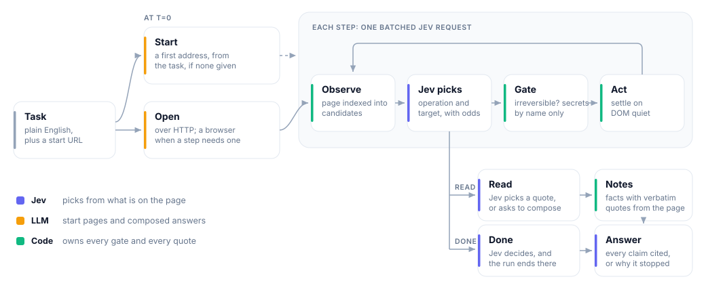

<div align="center">

<picture>
  <source media="(prefers-color-scheme: dark)" srcset="assets/wordmark-dark.svg">
  
</picture>

**Give your agent a browser.**

A browser agent that picks from the controls a page actually has, cites the page for every claim, and keeps
credentials, irreversible actions and spending under the control of code.

[](https://pypi.org/project/fastbrowse/)


</div>

---

## Why fastbrowse

- **It picks, it does not invent.** Each page is indexed into the controls it has, and
  [Jev](https://typesafe.ai), a choice model, picks one. It cannot click something that is not on the page, and
  there are no selectors to maintain.
- **Answers you can check.** Every claim in a complete answer cites a verbatim quote from the page, with a link
  that scrolls to it. Pass a schema and get validated data back.
  Tasks over a whole list can follow its next-page links, checking each page and preserving its citations.
- **Code holds the keys.** Submit, pay, delete and send stop until you allow them. A secret is typed only on the
  origin it was declared for, and models only see its name. Step, time and dollar limits are enforced in code.
- **Any browser.** A Browser Use Cloud browser by default, local Chrome, or any Chromium browser or Electron app
  that is already running.
- **Desktop apps too.** On Linux with Hyprland, `--desktop` starts a native app and drives it through its
  accessibility tree, in the background, with [deskpilot](https://github.com/cjber/deskpilot).
- **One agent, every interface.** A CLI, a Python library, Node and Go SDKs that need no Python, an MCP
  server, and a skill for coding agents.


Recorded on fastbrowse 0.10.0 and local Chrome against Sauce Demo, a public practice store: 16.4 seconds, 12 steps and
$0.0149 in model calls. The full-resolution recording is [docs/assets/demo.mp4](docs/assets/demo.mp4).

On 53 live tasks run three times each, against three other agents under the same limits on Browser Use cloud
browsers, fastbrowse 0.10.0 passed 89.9% of its 159 attempts to the hosted Browser Use agent's 94.1%, Browser
Harness's 88.2% and Jev Ultrafast's 4.6%, and cost $0.0150 a run to the hosted agent's $0.5508, 36.6x less. It
was fastest on 35 of the 50 tasks two or more agents passed, against 11 for the hosted agent. That is the
published campaign, release-0.10.0: 53 tasks at three repeats, run 2026-11-09, fastbrowse-evals at commit
`2e94d24`, judged by anthropic/claude-opus-5.5 through OpenRouter. The hosted agent passed more attempts than
fastbrowse on this suite; cost and speed are the measures fastbrowse leads. See
[How it compares](#how-it-compares) and [Benchmark results](docs/benchmarks.md) for the runs each arm's figure
excludes.

## Try it

You need [uv](https://docs.astral.sh/uv/), which fetches Python 3.13 or newer itself, an
[OpenRouter](https://openrouter.ai/) key and a [Browser Use](https://browser-use.com/) key:

```sh
export OPENROUTER_API_KEY=...   # Jev, the model that picks each action, and the LLM for start pages, written field values and composed answers
export BROWSER_USE_API_KEY=...  # the cloud browser; or pass --local to use your own Chrome
uvx fastbrowse "What is the title of the top story right now?" --start https://news.ycombinator.com/
```

With a Browser Use key the cloud browser is the default, because it passes bot checks a fresh local Chrome fails;
it also prints a URL to watch the run live. Without the key or `--local`, the command stops and asks for one.
`--local` runs in your own Chrome through the [fastbrowse extension](docs/cli.md#your-own-chrome), signed in as you
are, and `--launch` starts a separate signed-out Chrome instead.
`AI_GATEWAY_API_KEY` (Vercel AI Gateway) serves the LLM when `OPENROUTER_API_KEY` is unset. With both keys,
the automatically selected OpenRouter LLM moves to the gateway for the rest of the run if OpenRouter refuses its key.
Jev can also run through the gateway as a last resort, or another decision host with `FASTBROWSE_DECISION_SOURCE`.
[Jev routing](docs/jev.md#provider-failover) covers the order and [other hosts](docs/jev.md#other-decision-hosts).

Keys can live in a `.env` file in the working directory ([`.env.example`](.env.example) lists every setting), but
values named by `--secret` must be in the process environment. `uv tool install fastbrowse` keeps the command on
your PATH, `uv add fastbrowse` adds it to a project, and `npm install fastbrowse` gives Node.js the same agent with
no Python. `fastbrowse self-update` names how a copy was installed and prints the command that upgrades it.

To work on fastbrowse itself:

```sh
git clone https://github.com/agent-labs-dev/fastbrowse.git && cd fastbrowse
uv sync --all-extras   # builds the Rust core, so it needs cargo (rustup installs the pinned toolchain)
cp .env.example .env   # then fill in the keys, or pass --local
uv run fastbrowse "What is the title of the top story right now?" --start https://news.ycombinator.com/
```

Steps go to stderr; the status, cost, step count, why a run stopped short, and the answer go to stdout. `--json`
prints the full result: every step, the quotes behind the answer, cost by component, and the build that ran it. The
exit code is the status, and only `complete` exits 0.

```sh
export SAUCE_PASSWORD=secret_sauce
uvx fastbrowse "Log in as standard_user with the saved password and add the backpack to the cart." \
  --start https://www.saucedemo.com/ --secret password=SAUCE_PASSWORD --authorize --launch
```

The [command-line reference](docs/cli.md#flags) has every flag, signed-in profiles and Bitwarden logins, driving open
windows, Electron and [desktop apps](docs/cli.md#desktop-apps), model and provider settings, and every status with its exit code.

## How it compares

| | Browser Use agent (hosted) | [Browser Use Ultrafast](https://github.com/browser-use/jev-ultrafast) (`jev-ultrafast`) | fastbrowse |
|:--|:--|:--|:--|
| Choosing an action | hosted model and tools | Jev picks from indexed controls | Jev picks from indexed controls |
| Returns | an answer | `DONE` or `BLOCKED` | an answer with quotes, or why it stopped |
| Cited answers | not graded for citations here | no cited-answer result API | answers backed by captured quotes |
| Signing in | yes | password fields excluded | `--secret` or a Bitwarden vault item; models see names only |
| Irreversible actions | explicit task instructions in our fixture tests | no authorization parameter in Agent | classifier plus a code-enforced authorization gate |
| Browser | cloud | Chrome through Browser Harness; cloud in these evals | cloud by default, or local Chrome with `--local` |

The Ultrafast column describes
[commit 1231850a](https://github.com/browser-use/jev-ultrafast/tree/1231850a0bf1a0c0341fe408ef1668dbbfdfac46),
the version the eval runner pins.

Benchmarking makes three comparisons:

- **C1, agent against agent:** fastbrowse against the hosted Browser Use agent, Browser Harness and Jev
  Ultrafast, the figures above, on the same tasks on Browser Use cloud browsers under identical limits with each
  agent at its own defaults. On the same 53-task catalog, fastbrowse alone passed 90.5% of its 159 attempts at
  $0.0149 a run. Jev Ultrafast, the fourth arm of that live suite, passed 4.6% of 129 attempts at $0.0017 a run
  and was fastest on 2 of the 50 tasks two or more agents passed. It cannot return an answer, so every task that
  asks a question fails, and 6 of the 53 tasks are counted as failures: five need login credentials it has no way
  to be given, and saucedemo-pause needs a pause before an irreversible step, which it cannot make.
- **C2, browser against browser:** the same fastbrowse build on its own browser pool and on a Browser Use Cloud
  browser. In an earlier record (release-0.5.25), not on the published page, the pool passed fewer tasks.
- **C3, fastbrowse on its own browser pool against `jev-ultrafast`:** not yet measured. The pairing over the 6
  navigation tasks both run has not been run; the Ultrafast figures above are C1's, on a Browser Use cloud browser
  like every arm of that campaign. Browser Use's vendor-reported 22 seconds and $0.0064 a task for Ultrafast cover
  the model and the search only, with the browser and proxy billed separately, so they are not comparable with our
  figures.

The [benchmark page](https://fastbrowse.ai/benchmarks) publishes campaign release-0.10.0 (fastbrowse-evals at
commit `2e94d24`, run 2026-11-09, judged by anthropic/claude-opus-5.5 through OpenRouter). 0.10.0, tagged
2026-11-10, is the current release, so the published campaign measures the build that ships; no campaign
measured on a 0.10.1 build has been published yet, so nothing above describes 0.10.1.
[Benchmark results](docs/benchmarks.md) gives the sources, cost basis, each arm's excluded runs and the
limitations, and [eval results and workflow](docs/evals.md) covers the diagnostic suites.

## How it works

<picture>
  <source media="(prefers-color-scheme: dark)" srcset="assets/architecture-dark.svg">
  
</picture>

Jev picks each action, reads each page and decides when the run is done. An LLM proposes the first address when none is given and writes an answer that has to be composed. Code owns the gates: irreversible actions stop without
`--authorize`, secrets reach models by name only, and supported cookie banners are refused through autoconsent.
More in [docs/design.md](docs/design.md).

The core is Rust, in [crates/](crates), and every interface hands its work to it; the wheel carries it as
`fastbrowse._native` ([ADR 0004](docs/adr/0004-rust-core-by-default.md)). Against the Python core it replaced, it
reached the same result on all 36 fixture tasks with 18x less agent CPU, 54x faster startup and 5.4x less peak
memory ([measurements](bench/results/rust-vs-python.md)).

## Embed it

`uv add fastbrowse` first, then:

```python
import asyncio

from pydantic import BaseModel

from fastbrowse import run_task
from fastbrowse.models import Limits


class Release(BaseModel):
    package: str
    version: str


async def main() -> None:
    result = await run_task(
        "Find the httpx package and report its name and latest released version.",
        start="https://pypi.org/",
        output_schema=Release,
        limits=Limits(max_dollars=0.10),
    )
    print(result.status, result.data, f"${result.cost.known_dollars:.4f}")
    for evidence in result.evidence:
        print(f'  "{evidence.quote}" from {evidence.url}')


asyncio.run(main())
```

**Choosing the browser.** With no browser argument, `run_task` starts a Browser Use Cloud browser with
`BROWSER_USE_API_KEY`, or the key in `browser_api_key=`. `chrome=LocalChrome()` runs local Chrome instead, and
`cloud_extensions=[...]` loads up to three of your account's Browser Use Cloud extensions into a cloud browser. `cdp_url=` or `cdp_port=` drives a browser already running: the run opens and closes its own tab and leaves
the rest, though cookies the task sets can persist. `attach=True`, `target_match=` and `foreground=True` work as
the matching flags do. Passing a cloud key and a CDP address together is an error.

**Recipes and recordings.** `save_recipe=Path("recipe.json")` stores the actions of a completed run. A write failure is logged without changing the task status; check the file before replay.
Pass `recipe=Path("recipe.json")` with the same task to reuse values when Jev selects a matching live action.
A changed page or control falls back to the agent. Reading and completion are always checked live.
Naming the same file for both arguments saves the healed sequence after another completed run.
Recipes can contain personal information from ordinary fields; stored secrets are kept only by name.
`fastbrowse.recipes.validate_recipe()` checks recipe JSON with the same Rust parser as the file loader;
`recipe_schema()` exports its JSON Schema for client validation.
`record=Path("run.mp4")` writes captioned and plain videos, and needs ffmpeg. The action cursor also needs ffprobe; if frame dimensions cannot be read, the cursor is omitted with a warning.

**A cloud browser that outlives a run.** `open_cloud_browser(browser_api_key=...)` starts a Browser Use Cloud
browser no run owns and returns a `CloudBrowser` with its `id`, `cdp_url` and `live_url`. It takes `run_task`'s
cloud options without the `cloud_` prefix (`profile=`, `extensions=`, `timeout_minutes=` and the rest). Runs given
its `cdp_url` with `attach=True` leave it running, and `stop_cloud_browser(browser, browser_api_key=...)` stops
it; until then it bills, up to its timeout. A start that fails or is cancelled stops the browser it created.

```python
from fastbrowse import open_cloud_browser, run_task, stop_cloud_browser


async def main() -> None:
    browser = await open_cloud_browser(browser_api_key=KEY, profile=PROFILE_ID, timeout_minutes=60)
    print("watch at", browser.live_url)
    try:
        await run_task("Open my inbox.", cdp_url=browser.cdp_url, attach=True)
    finally:
        await stop_cloud_browser(browser, browser_api_key=KEY)
```

**Your own script on the page.** `connect_cdp()` hands you the attached page without the agent:

```python
from fastbrowse import connect_cdp


async def main() -> None:
    async with connect_cdp(9222, target_match="my-project") as page:
        print(await page.observe())
```

**Moving from 0.8.** The Python modules that 0.9 removed with the Python core have these replacements:

| 0.8 import | Now |
|---|---|
| `fastbrowse.adapters.browser_use_cloud.BrowserUseCloudBrowser` | `open_cloud_browser` to start one and `stop_cloud_browser` to stop it, without the `http=` and `allow_resizing=` arguments |
| `fastbrowse.models.BrowserConnection` | `fastbrowse.CloudBrowser`, holding `id`, `cdp_url` and `live_url` |
| `fastbrowse.clients.environment.Settings` | `run_task(settings={...})`, keyed by the environment variable names |
| `fastbrowse.adapters.totp` (`TotpError`, `one_time_code`) | `fastbrowse.totp` |

**Access controls:**

- `allowed_origins=["https://app.example.com"]` limits the documents a run may read and control to those exact
  origins. Navigations, redirects, frames and popups elsewhere are refused before they are sent, so a sign-in
  that redirects through another origin needs it listed too. It scopes documents, not the network, and a scoped
  run sends no live frames or screenshots and cannot record. The JavaScript, Go, Java and .NET clients take it as
  `allowedOrigins` or `AllowedOrigins`.
- `check_access=`, which only the Python API offers, is an async callback awaited before the browser starts and
  before every read, navigation and action. If it raises, the run ends with status `error` (`connect_cdp` raises `BrowserError`), naming only the
  exception's type.

**Citations.** `result.citations` holds a `Citation` per numbered link in `result.answer`: `id`, `text`,
`url`, `quote` and `deep_link`. Each claim cites the notes it states. A count, total, cheapest or largest
value is worked out in code from every note read and cites each record it rests on. A `quote` is the page's text, a table row as its cells separated by spaces. A `deep_link` is a [text fragment](https://wicg.github.io/scroll-to-text-fragment/#syntax) URL that
scrolls to the quote; it may not resolve on a page that changes or needs a session. Each page a quote was read from
is kept as a `capture` artifact in `result.artifacts`, holding the masked page text, and the quote's `Evidence`
names it in `capture_artifact`; `start` and `end` index into that text. Its `links` lists each link inside the
quote: the link's `text`, where that text sits as `start` and `end`, and the `href` it leads to. Captures go where downloads go, so pass
`downloads` or `artifact_sink` to keep them past the run. A page fetched over HTTP keeps none.

**Watching a run.**

- `on_event=` gets a `BrowserEvent` with a cloud browser's live-view URL, then a `StepEvent` per step, carrying the
  facts that step added. `Config(step_frames=True)` adds a PNG of each step's page.
- A task requesting a final screenshot receives a safe PNG in `result.final_frame` without enabling step frames.
  JSON clients receive a `screenshot` artifact with a base64 data URI. A missing requested image leaves a
  completed task `unverified`.
- `Config(step_choices=True)` adds `choices` to each step Jev decided: the controls it was offered, each with its
  `id`, `role`, masked `label` and `context` (the card or row that tells twins apart) and `operations`, and the one
  it picked marked `chosen` (a drag marks its destination too). It shows whether the element
  a run should have used was there to pick. Off, a step has no `choices` key.
- `on_frame=` gets JPEG frames of the active tab as they render. The handler runs on your event loop, so it
  must honour cancellation: one that swallows `CancelledError` keeps `asyncio.run` waiting at shutdown.

  A cancelled `run_task` raises `fastbrowse.models.RunCancelled`, an `asyncio.CancelledError` with a `receipt`
  of reported steps, known cost lines and finished recordings once the browser closes. A cancellation before
  the core starts may have no receipt. The receipt has no status or answer; unpriced charges stay `unknown`.
  `ConfigurationError` and `RecordingError` also carry a `receipt` when they stop a run after work or charges
  have accrued; otherwise their `receipt` is `None`. JSON-RPC preserves this receipt in error data, or in the
  error result for recording failures. MCP keeps it in `_meta["fastbrowse.ai/receipt"]` beside the tool error.
  A callback failure raises the original exception with a `receipt` attribute when the core retains one,
  including when the callback fails as the run completes.
- `with traced() as events:` collects the run's trace in-process, as `--trace` writes it.

No frame or screenshot is sent while a resolved secret may show on the page.

`run_task(jev=...)` and `run_task(llm=...)` take your own decision model or LLM client; a `jev` client is asked at
Jev's limits and thresholds. See [Jev routing](docs/jev.md#provider-failover) and `fastbrowse.llm`.

**Choosing the model backend without the environment.** New in 0.9.1.
`run_task(settings={...})` takes the same names as the
environment variables (`OPENROUTER_API_KEY`, `AI_GATEWAY_API_KEY`, `TYPESAFE_API_KEY`, `FASTBROWSE_DECISION_SOURCE`,
`FASTBROWSE_LLM_PROVIDER`, `FASTBROWSE_LLM_MODEL` and the rest) and reads them instead of the environment and
`.env`, so a service that keeps its credentials elsewhere hands the run exactly the keys it means to:

```python
result = await run_task("Find the latest httpx release", settings={"OPENROUTER_API_KEY": my_key})
```

**The same rules outside a run.** New in 0.9.1. `fastbrowse.origins` (`origin_of`, `parse_origin`) parses `allowed_origins` as the
run does; `fastbrowse.safety` (`secret_allowed`, `origin_of`, `ScopedSecrets`) answers where a secret may be typed,
`*.` patterns included; `fastbrowse.totp.one_time_code(key)` makes the codes an authenticator key gives. Each wraps
the core's own rule, so the answer before a run is the one the run gives.

## Use it from JavaScript

`npm install fastbrowse` gives a Node.js 20+ program the same agent with no Python on the machine. The SDK has no
dependencies; npm also installs a native binary for your platform (`@fastbrowse/darwin-arm64`, `darwin-x64`,
`linux-arm64`, `linux-x64` or `win32-x64`). No install script runs and nothing downloads on first use. It reads
the same keys from your environment, and finds local Chrome, starts a cloud browser or drives one already running,
as the CLI does.

```sh
npm install fastbrowse zod
export OPENROUTER_API_KEY=...
```

```ts
import { Fastbrowse } from 'fastbrowse';
import { z } from 'zod';

const Release = z.object({ package: z.string(), version: z.string() });

const fb = await Fastbrowse.start({ local: true });
try {
  const result = await fb.run('Find the httpx package and report its name and latest released version.', {
    start: 'https://pypi.org/',
    output: Release,
    limits: { maxDollars: 0.1 },
    onEvent: event => {
      if (event.type === 'step') console.error(event.step.operation, event.step.target);
    },
    signal: AbortSignal.timeout(120_000),
  });
  console.log(result.status, result.answer);
  if (result.status === 'complete') console.log(result.output.package, result.output.version);
  for (const evidence of result.evidence) console.log(`  "${evidence.quote}" from ${evidence.url}`);
} finally {
  await fb.close();
}
```

- One instance runs one task at a time; start more instances to run side by side. The process exits with yours.
- `run` resolves with the result whatever the status. It rejects when no run finished (`RpcError` for a refused
  request, `AbortError` when `signal` stopped it, `ProcessExitedError` when the process is gone), and with
  `OutputValidationError` when the data fails your schema.
- The result is Python's `RunResult`, with Python field names. `output` is `data` validated by your Zod (4.2+),
  ArkType or Valibot schema, or a plain JSON Schema; data the schema refuses rejects with `OutputValidationError`.
  A run fills a flat object of required string, number, integer and boolean fields.

Secrets and the final check stay in your code:

```ts
await fb.run('Log in as standard_user with the saved password and add the backpack to the cart.', {
  start: 'https://www.saucedemo.com/',
  authorization: { irreversibleActions: true },
  secrets: {
    refs: [{ name: 'password', origins: ['https://www.saucedemo.com'] }],
    resolve: name => vault.get(name),
  },
  until: url => url.endsWith('/cart.html'),
});
```

`resolve` is called each time a value is typed, only on an origin its ref covers. `until` gets the final address,
and anything but `true` keeps the run from `complete`. The other options are `run_task`'s in camelCase; the
[SDK README](packages/sdk/README.md) lists them with the error model.

There is no binary for musl systems such as Alpine; point `binaryPath` or `FASTBROWSE_BINARY` at your own. The
macOS binaries are ad-hoc signed, not notarized, and the Windows binary is unsigned. Bun and Deno are untested.

## Use it from Go

The [Go module](go) starts the fastbrowse binary and runs tasks over the same protocol the JavaScript SDK uses:

```sh
go get github.com/agent-labs-dev/fastbrowse/go
```

```go
client, err := fastbrowse.Start(ctx, fastbrowse.Options{})
if err != nil {
	return err
}
defer client.Close(context.Background())
result, err := client.Run(ctx, "What is the top story's title?", fastbrowse.RunOptions{
	Start: "https://news.ycombinator.com/",
})
```

The first `Start` downloads the release's binary for the platform into the user cache directory, checked against
the SHA-256 the module pins; `Options.BinaryPath` or `FASTBROWSE_BINARY` names another. Cancelling `ctx` stops a run
once its browser has closed. `RunOptions` takes the same options as the SDK: `OutputSchema`, `Secrets`, `Until`,
`OnEvent` and `OnFrame`. One client runs one task at a time.

## Rust, Java and .NET

Clients for Rust ([crates/fastbrowse](crates/fastbrowse)), Java and Kotlin ([java](java)) and .NET
([dotnet](dotnet)) are in this repository and run tasks the way the JavaScript and Go SDKs do. None is on
crates.io, Maven Central or NuGet yet, so `cargo add fastbrowse`, the Maven coordinates and
`dotnet add package Fastbrowse` do not resolve today.

## Use fastbrowse with your agent

Install the [fastbrowse skill](docs/skill.md) to delegate website tasks from any agent that supports Agent
Skills, such as Codex or Claude Code. It uses the MCP server when connected, or the CLI, and keeps the task's
citations, status, authorization and budget. [Nebula](https://www.nebula.gg/) also runs fastbrowse in its agent
harness, with Bitwarden or 1Password logins scoped to authorized websites.

## Use it from an MCP client

`fastbrowse-mcp` serves one `browse` tool over [MCP](https://modelcontextprotocol.io) to Claude Code, Claude
Desktop, Cursor or any MCP client. It returns the answer with numbered citation links, typed `fields` if asked
for, the quotes behind them, the status and what to do next, and reports progress every step.

```sh
claude mcp add fastbrowse -e OPENROUTER_API_KEY=... -e BROWSER_USE_API_KEY=... \
  -- uvx --from fastbrowse fastbrowse-mcp --max-dollars 0.25
```

For a client configured by JSON, such as Claude Desktop:

```json
{
  "mcpServers": {
    "fastbrowse": {
      "command": "uvx",
      "args": ["--from", "fastbrowse", "fastbrowse-mcp"],
      "env": { "OPENROUTER_API_KEY": "...", "BROWSER_USE_API_KEY": "..." }
    }
  }
}
```

The server's flags set what a calling model may do; a call can ask for less, never more.

| Flag | Effect |
|:--|:--|
| `--local`, `--launch`, `--headed`, `--profile DIR`, `--foreground`, `--downloads DIR`, `--cursor`, `--no-cursor` | as for the CLI, fixed for every call |
| `--cloud-profile ID` | every call runs as that cloud profile |
| `--extension`, `--extension-browser LABEL` | every call runs in your own Chrome through the fastbrowse extension; see [Your own Chrome](docs/cli.md#your-own-chrome) |
| `--allow-authorize` | let a call pass `authorize`; without it irreversible actions always stop at `needs_confirmation` |
| `--secret NAME=ENV_VAR@ORIGIN` | typed when a call's start page is on `ORIGIN`; the model sees `NAME` only |
| `--bitwarden ITEM` | a vault login a call may name in `bitwarden` |
| `--max-steps N`, `--max-dollars N`, `--max-seconds N` | ceilings per call; unlimited by default |
| `--max-concurrent N` | runs at once, default 1; more calls wait |
| `--transport http`, `--host`, `--port` | streamable HTTP at `/mcp` instead of stdio |

Over HTTP, set `FASTBROWSE_MCP_TOKEN` and every request but `/healthz` needs `Authorization: Bearer <token>`; the
server refuses to bind beyond loopback without one. A run takes seconds to minutes, so raise the client's tool
timeout if it has one (`MCP_TOOL_TIMEOUT` in Claude Code).

## Safety model

- **Irreversible actions.** Jev judges each click, key chord and dialog acceptance, including Enter presses. Without authorization, a
  irreversible action stops at `needs_confirmation`. This is a
  classifier, not a guarantee: a page can word a harmful control to look harmless.
- **Secrets.** Models see names only. A value is resolved at the moment it is typed, only on its declared origin,
  and redacted from everything the run returns. A password field is typed only from a stored secret.
- **Page content is data.** Every prompt says so, and what a run reports is copied from quotes on the page.

## Evals and development

[Eval commands](docs/evals.md) cover running suites, publishing results and regenerating evidence; the
[compact results feed](docs/results/summary.json) is generated from published rows. See
[CONTRIBUTING.md](CONTRIBUTING.md) for setup and checks, [docs/design.md](docs/design.md) for the browser layer,
and [docs/jev.md](docs/jev.md) for the Jev assumptions checked against Typesafe's documentation.

## Changelog

[CHANGELOG.md](CHANGELOG.md) records each release, and every
[GitHub release](https://github.com/agent-labs-dev/fastbrowse/releases) publishes its entry.

## Credits

Thanks to Dhaiwat10, jmclark-lab and imranye for code, to Adam13y for the known-answer safety scenarios, and to
everyone who reported a bug or asked for a feature, here or on Product Hunt. [CREDITS.md](CREDITS.md) has the full
list.

## License

MIT, copyright Agent Labs. Adapted third-party code is credited in [NOTICE](NOTICE).
