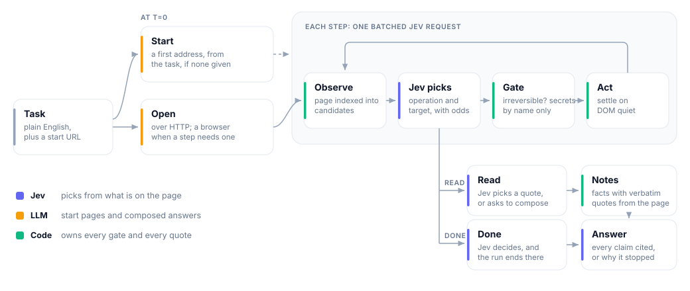

<div align="center">

<picture>
  <source media="(prefers-color-scheme: dark)" srcset="assets/wordmark-dark.svg">
  
</picture>

**Give your agent a browser.**

A browser agent that picks from the controls a page actually has, cites the page for every claim, and keeps
credentials, irreversible actions and spending under the control of code.

[](https://pypi.org/project/fastbrowse/)


</div>

---

## Why fastbrowse

- **It picks, it does not invent.** Each page is indexed into the controls it has, and
  [Jev](https://typesafe.ai), a choice model, picks one. It cannot click something that is not on the page, and
  there are no selectors to maintain.
- **Answers you can check.** Every claim in a complete answer cites a verbatim quote from the page, with a link
  that scrolls to it. Pass a schema and get validated data back.
- **Code holds the keys.** Submit, pay, delete and send stop until you allow them. A secret is typed only on the
  origin it was declared for, and models only see its name. Step, time and dollar limits are enforced in code.
- **Any browser.** A Browser Use Cloud browser by default, local Chrome, or any Chromium browser or Electron app
  that is already running.
- **One agent, every interface.** A CLI, a Python library, Node and Go SDKs that need no Python, an MCP
  server, and a skill for coding agents.


Recorded on local Chrome against thepihut.com: 37 steps, about 4 minutes and $0.29 in model calls. Playback is sped
up with pauses cut. The full-resolution recording is [docs/assets/demo.mp4](docs/assets/demo.mp4).

On 46 tasks run three times each against the hosted Browser Use agent, under the same limits on Browser Use
Cloud browsers, fastbrowse passed 99.2% of runs to 96.3% and cost $0.0296 a run to $0.3180, 10.7x less. It was
slower: 18.9s a task to 15.3s. These figures are the published campaign, release-0.7.1; see
[How it compares](#how-it-compares).

## Try it

You need [uv](https://docs.astral.sh/uv/), which fetches Python 3.13 or newer itself, Chrome or Chromium, and an
[OpenRouter](https://openrouter.ai/) key:

```sh
export OPENROUTER_API_KEY=...
uvx fastbrowse "What is the title of the top story right now?" --start https://news.ycombinator.com/ --local
```

That one key serves both models: the LLM that plans, reads and writes, and Jev, the model that picks each action.
`--local` runs the Chrome on your machine; `FASTBROWSE_CHROME` names the binary if it is not found.

For regular use, add two keys and drop `--local`:

```sh
export TYPESAFE_API_KEY=...     # Jev direct from Typesafe, the recommended route
export BROWSER_USE_API_KEY=...  # a Browser Use Cloud browser
uvx fastbrowse "What is the title of the top story right now?" --start https://news.ycombinator.com/
```

With a Browser Use key the cloud browser is the default, because it passes bot checks a fresh local Chrome fails;
it also prints a URL to watch the run live. Without the key or `--local`, the command stops and asks for one.
`AI_GATEWAY_API_KEY` (Vercel AI Gateway) serves the LLM when `OPENROUTER_API_KEY` is unset. Jev can also run
through the gateway as a last resort, or another decision host with `FASTBROWSE_DECISION_SOURCE`.
[Jev routing](docs/jev.md#provider-failover) covers the order and [other hosts](docs/jev.md#other-decision-hosts).

Keys can live in a `.env` file in the working directory ([`.env.example`](.env.example) lists every setting), but
values named by `--secret` must be in the process environment. `uv tool install fastbrowse` keeps the command on
your PATH, `uv add fastbrowse` adds it to a project, and `npm install fastbrowse` gives Node.js the same agent with
no Python.

To work on fastbrowse itself:

```sh
git clone https://github.com/agent-labs-dev/fastbrowse.git && cd fastbrowse
uv sync --all-extras   # builds the Rust core, so it needs cargo (rustup installs the pinned toolchain)
cp .env.example .env   # then fill in the keys, or pass --local
uv run fastbrowse "What is the title of the top story right now?" --start https://news.ycombinator.com/
```

Steps go to stderr; the status, cost, step count, why a run stopped short, and the answer go to stdout. `--json`
prints the full result: every step, the quotes behind the answer, and cost by component. The exit code is the
status, and only `complete` exits 0.

```sh
export SAUCE_PASSWORD=secret_sauce
uvx fastbrowse "Log in as standard_user with the saved password and add the backpack to the cart." \
  --start https://www.saucedemo.com/ --secret password=SAUCE_PASSWORD --authorize --local
```

The [command-line reference](docs/cli.md#flags) has every flag, signed-in profiles and Bitwarden logins, driving open
windows and Electron apps, model and provider settings, and every status with its exit code.

## How it compares

| | Browser Use agent (hosted) | [Browser Use Ultrafast](https://github.com/browser-use/jev-ultrafast) (`jev-ultrafast`) | fastbrowse |
|:--|:--|:--|:--|
| Choosing an action | hosted model and tools | Jev picks from indexed controls | Jev picks from indexed controls |
| Returns | an answer | `DONE` or `BLOCKED` | an answer with quotes, or why it stopped |
| Cited answers | not graded for citations here | no cited-answer result API | answers backed by captured quotes |
| Signing in | yes | password fields excluded | `--secret` or a Bitwarden vault item; models see names only |
| Irreversible actions | explicit task instructions in our fixture tests | no authorization parameter in Agent | classifier plus a code-enforced authorization gate |
| Browser | cloud | Chrome through Browser Harness; cloud in these evals | cloud by default, or local Chrome with `--local` |

The Ultrafast column describes
[commit 1231850a](https://github.com/browser-use/jev-ultrafast/tree/1231850a0bf1a0c0341fe408ef1668dbbfdfac46),
the version the eval runner pins.

Benchmarking makes three comparisons:

- **C1, agent against agent:** fastbrowse against the hosted Browser Use agent, the figures above, on Browser
  Use cloud browsers under identical limits with the hosted agent at its defaults. On its own 53-task catalog,
  fastbrowse passed 99.3% at 17.0s and $0.0268 a run.
- **C2, browser against browser:** the same fastbrowse build on its own browser pool and on a Browser Use Cloud
  browser. In an earlier record (release-0.5.25), not on the published page, the pool passed fewer tasks.
- **C3, fastbrowse on its pool against `jev-ultrafast`,** over 6 tasks: not yet measured.

The [benchmark page](https://fastbrowse.ai/benchmarks) publishes campaign release-0.7.1 (agent commit `7b8b0e8f`,
data sha256 `7d6ac26f23fa6d354128fa7e4bcc8190125c441f4f136dc39d0e3c35cec5d4e2`).
[Benchmark results](docs/benchmarks.md) gives the sources, cost basis and limitations, and
[eval results and workflow](docs/evals.md) covers the diagnostic suites.

## How it works

<picture>
  <source media="(prefers-color-scheme: dark)" srcset="assets/architecture-dark.svg">
  
</picture>

The LLM plans, reads and writes. Jev picks each action. Code owns the gates: irreversible actions stop without
`--authorize`, secrets reach models by name only, and supported cookie banners are refused through autoconsent.
More in [docs/design.md](docs/design.md).

The core is Rust, in [crates/](crates), and every interface hands its work to it; the wheel carries it as
`fastbrowse._native` ([ADR 0004](docs/adr/0004-rust-core-by-default.md)). Against the Python core it replaced, it
reached the same result on all 36 fixture tasks with 18x less agent CPU, 54x faster startup and 5.4x less peak
memory ([measurements](bench/results/rust-vs-python.md)).

## Embed it

`uv add fastbrowse` first, then:

```python
import asyncio

from pydantic import BaseModel

from fastbrowse import run_task
from fastbrowse.models import Limits


class Release(BaseModel):
    package: str
    version: str


async def main() -> None:
    result = await run_task(
        "Find the httpx package and report its name and latest released version.",
        start="https://pypi.org/",
        output_schema=Release,
        limits=Limits(max_dollars=0.10),
    )
    print(result.status, result.data, f"${result.cost.known_dollars:.4f}")
    for evidence in result.evidence:
        print(f'  "{evidence.quote}" from {evidence.url}')


asyncio.run(main())
```

**Choosing the browser.** With no browser argument, `run_task` runs local Chrome. `browser_api_key=` starts a
cloud browser, and `cloud_extensions=[...]` loads up to three of your account's Browser Use Cloud extensions into
it. `cdp_url=` or `cdp_port=` drives a browser already running: the run opens and closes its own tab and leaves
the rest, though cookies the task sets can persist. `attach=True`, `target_match=` and `foreground=True` work as
the matching flags do. Passing a cloud key and a CDP address together is an error.

**Your own script on the page.** `connect_cdp()` hands you the attached page without the agent, and
`resolve_cdp_port(port)` returns the `ws://` URL behind a DevTools port:

```python
from fastbrowse import connect_cdp


async def main() -> None:
    async with connect_cdp(9222, target_match="my-project") as page:
        print(await page.observe())
```

**Access controls** that only the Python API offers:

- `allowed_origins=["https://app.example.com"]` limits the documents a run may read and control to those exact
  origins. Navigations, redirects, frames and popups elsewhere are refused before they are sent, so a sign-in
  that redirects through another origin needs it listed too. It scopes documents, not the network, and a scoped
  run sends no live frames or screenshots and cannot record.
- `check_access=` is an async callback awaited before the browser starts and before every read, navigation and
  action. If it raises, the run ends with status `error` (`connect_cdp` raises `BrowserError`), naming only the
  exception's type.

**Citations.** `result.citations` holds a `Citation` per numbered link in `result.answer`: `id`, `text`,
`requirement_id`, `url`, `quote` and `deep_link`. Counts, totals and superlatives cite every record they were
derived from. A `deep_link` is a [text fragment](https://wicg.github.io/scroll-to-text-fragment/#syntax) URL that
scrolls to the quote; it may not resolve on a page that changes or needs a session.

**Watching a run.**

- `on_event=` gets a `BrowserEvent` with a cloud browser's live-view URL, then a `StepEvent` per step, carrying the
  facts that step added. `Config(step_frames=True)` adds a PNG of each step's page.
- `Config(step_choices=True)` adds `choices` to each step Jev decided: the controls it was offered, each with its
  `id`, `role`, masked `label` and `context` (the card or row that tells twins apart) and `operations`, and the one
  it picked marked `chosen` (a drag marks its destination too). It shows whether the element
  a run should have used was there to pick. Off, a step has no `choices` key.
- `on_frame=` gets JPEG frames of the active tab as they render. The handler runs on your event loop, so it
  must honour cancellation: one that swallows `CancelledError` keeps `asyncio.run` waiting at shutdown.
- `with traced() as events:` collects the run's trace in-process, as `--trace` writes it.

No frame or screenshot is sent while a resolved secret may show on the page.

`run_task(jev=...)` and `run_task(llm=...)` take your own decision model or LLM client; see
[Jev routing](docs/jev.md#provider-failover) and `fastbrowse.llm`.

**Choosing the model backend without the environment.** New in 0.9.1.
`run_task(settings={...})` takes the same names as the
environment variables (`OPENROUTER_API_KEY`, `AI_GATEWAY_API_KEY`, `TYPESAFE_API_KEY`, `FASTBROWSE_DECISION_SOURCE`,
`FASTBROWSE_LLM_PROVIDER`, `FASTBROWSE_LLM_MODEL` and the rest) and reads them instead of the environment and
`.env`, so a service that keeps its credentials elsewhere hands the run exactly the keys it means to:

```python
result = await run_task("Find the latest httpx release", settings={"OPENROUTER_API_KEY": my_key})
```

**The same rules outside a run.** New in 0.9.1. `fastbrowse.origins` (`origin_of`, `parse_origin`) parses `allowed_origins` as the
run does; `fastbrowse.safety` (`secret_allowed`, `origin_of`, `ScopedSecrets`) answers where a secret may be typed,
`*.` patterns included; `fastbrowse.totp.one_time_code(key)` makes the codes an authenticator key gives. Each wraps
the core's own rule, so the answer before a run is the one the run gives.

## Use it from JavaScript

`npm install fastbrowse` gives a Node.js 20+ program the same agent with no Python on the machine. The SDK has no
dependencies; npm also installs a native binary for your platform (`@fastbrowse/darwin-arm64`, `darwin-x64`,
`linux-arm64`, `linux-x64` or `win32-x64`). No install script runs and nothing downloads on first use. It reads
the same keys from your environment, and finds local Chrome, starts a cloud browser or drives one already running,
as the CLI does.

```sh
npm install fastbrowse zod
export TYPESAFE_API_KEY=...
export OPENROUTER_API_KEY=...
```

```ts
import { Fastbrowse } from 'fastbrowse';
import { z } from 'zod';

const Release = z.object({ package: z.string(), version: z.string() });

const fb = await Fastbrowse.start({ local: true });
try {
  const result = await fb.run('Find the httpx package and report its name and latest released version.', {
    start: 'https://pypi.org/',
    output: Release,
    limits: { maxDollars: 0.1 },
    onEvent: event => {
      if (event.type === 'step') console.error(event.step.operation, event.step.target);
    },
    signal: AbortSignal.timeout(120_000),
  });
  console.log(result.status, result.answer);
  if (result.status === 'complete') console.log(result.output.package, result.output.version);
  for (const evidence of result.evidence) console.log(`  "${evidence.quote}" from ${evidence.url}`);
} finally {
  await fb.close();
}
```

- One instance runs one task at a time; start more instances to run side by side. The process exits with yours.
- `run` resolves with the result whatever the status. It rejects when no run finished (`RpcError` for a refused
  request, `AbortError` when `signal` stopped it, `ProcessExitedError` when the process is gone), and with
  `OutputValidationError` when the data fails your schema.
- The result is Python's `RunResult`, with Python field names. `output` is `data` validated by your Zod (4.2+),
  ArkType or Valibot schema, or a plain JSON Schema; data the schema refuses rejects with `OutputValidationError`.
  A run fills a flat object of required string, number, integer and boolean fields.

Secrets and the final check stay in your code:

```ts
await fb.run('Log in as standard_user with the saved password and add the backpack to the cart.', {
  start: 'https://www.saucedemo.com/',
  authorization: { irreversibleActions: true },
  secrets: {
    refs: [{ name: 'password', origins: ['https://www.saucedemo.com'] }],
    resolve: name => vault.get(name),
  },
  until: url => url.endsWith('/cart.html'),
});
```

`resolve` is called each time a value is typed, only on an origin its ref covers. `until` gets the final address,
and anything but `true` keeps the run from `complete`. The other options are `run_task`'s in camelCase; the
[SDK README](packages/sdk/README.md) lists them with the error model.

There is no binary for musl systems such as Alpine; point `binaryPath` or `FASTBROWSE_BINARY` at your own. The
macOS binaries are ad-hoc signed, not notarized, and the Windows binary is unsigned. Bun and Deno are untested.

## Use it from Go

The [Go module](go) starts the fastbrowse binary and runs tasks over the same protocol the JavaScript SDK uses:

```sh
go get github.com/agent-labs-dev/fastbrowse/go
```

```go
client, err := fastbrowse.Start(ctx, fastbrowse.Options{})
if err != nil {
	return err
}
defer client.Close(context.Background())
result, err := client.Run(ctx, "What is the top story's title?", fastbrowse.RunOptions{
	Start: "https://news.ycombinator.com/",
})
```

The first `Start` downloads the release's binary for the platform into the user cache directory, checked against
the SHA-256 the module pins; `Options.BinaryPath` or `FASTBROWSE_BINARY` names another. Cancelling `ctx` stops a run
once its browser has closed. `RunOptions` takes the same options as the SDK: `OutputSchema`, `Secrets`, `Until`,
`OnEvent` and `OnFrame`. One client runs one task at a time.

## Rust, Java and .NET

Clients for Rust ([crates/fastbrowse](crates/fastbrowse)), Java and Kotlin ([java](java)) and .NET
([dotnet](dotnet)) are in this repository and run tasks the way the JavaScript and Go SDKs do. None is on
crates.io, Maven Central or NuGet yet, so `cargo add fastbrowse`, the Maven coordinates and
`dotnet add package Fastbrowse` do not resolve today.

## Use fastbrowse with your agent

Install the [fastbrowse skill](docs/skill.md) to delegate website tasks from any agent that supports Agent
Skills, such as Codex or Claude Code. It uses the MCP server when connected, or the CLI, and keeps the task's
citations, status, authorization and budget. [Nebula](https://www.nebula.gg/) also runs fastbrowse in its agent
harness, with Bitwarden or 1Password logins scoped to authorized websites.

## Use it from an MCP client

`fastbrowse-mcp` serves one `browse` tool over [MCP](https://modelcontextprotocol.io) to Claude Code, Claude
Desktop, Cursor or any MCP client. It returns the answer with numbered citation links, typed `fields` if asked
for, the quotes behind them, the status and what to do next, and reports progress every step.

```sh
claude mcp add fastbrowse -e TYPESAFE_API_KEY=... -e OPENROUTER_API_KEY=... -e BROWSER_USE_API_KEY=... \
  -- uvx --from fastbrowse fastbrowse-mcp --max-dollars 0.25
```

For a client configured by JSON, such as Claude Desktop:

```json
{
  "mcpServers": {
    "fastbrowse": {
      "command": "uvx",
      "args": ["--from", "fastbrowse", "fastbrowse-mcp"],
      "env": { "TYPESAFE_API_KEY": "...", "OPENROUTER_API_KEY": "...", "BROWSER_USE_API_KEY": "..." }
    }
  }
}
```

The server's flags set what a calling model may do; a call can ask for less, never more.

| Flag | Effect |
|:--|:--|
| `--local`, `--headed`, `--profile DIR`, `--foreground`, `--downloads DIR`, `--cursor`, `--no-cursor` | as for the CLI, fixed for every call |
| `--cloud-profile ID` | every call runs as that cloud profile |
| `--allow-authorize` | let a call pass `authorize`; without it irreversible actions always stop at `needs_confirmation` |
| `--secret NAME=ENV_VAR@ORIGIN` | typed when a call's start page is on `ORIGIN`; the model sees `NAME` only |
| `--bitwarden ITEM` | a vault login a call may name in `bitwarden` |
| `--max-steps N`, `--max-dollars N`, `--max-seconds N` | ceilings per call; unlimited by default |
| `--max-concurrent N` | runs at once, default 1; more calls wait |
| `--transport http`, `--host`, `--port` | streamable HTTP at `/mcp` instead of stdio |

Over HTTP, set `FASTBROWSE_MCP_TOKEN` and every request but `/healthz` needs `Authorization: Bearer <token>`; the
server refuses to bind beyond loopback without one. A run takes seconds to minutes, so raise the client's tool
timeout if it has one (`MCP_TOOL_TIMEOUT` in Claude Code).

## Safety model

- **Irreversible actions.** Jev judges each click, Enter press and dialog acceptance. Without authorization, a
  confident irreversible action stops at `needs_confirmation`, and an uncertain one goes to recovery. This is a
  classifier, not a guarantee: a page can word a harmful control to look harmless.
- **Secrets.** Models see names only. A value is resolved at the moment it is typed, only on its declared origin,
  and redacted from everything the run returns. A password field is typed only from a stored secret.
- **Page content is data.** Reader and verifier prompts say so, and completion is judged against quotes and page
  state, not the model's say-so.

## Evals and development

[Eval commands](docs/evals.md) cover running suites, publishing results and regenerating evidence; the
[compact results feed](docs/results/summary.json) is generated from published rows. See
[CONTRIBUTING.md](CONTRIBUTING.md) for setup and checks, [docs/design.md](docs/design.md) for the browser layer,
and [docs/jev.md](docs/jev.md) for the Jev assumptions checked against Typesafe's documentation.

## Changelog

[CHANGELOG.md](CHANGELOG.md) records each release, and every
[GitHub release](https://github.com/agent-labs-dev/fastbrowse/releases) publishes its entry.

## Credits

Thanks to Dhaiwat10, jmclark-lab and imranye for code, to Adam13y for the known-answer safety scenarios, and to
everyone who reported a bug or asked for a feature, here or on Product Hunt. [CREDITS.md](CREDITS.md) has the full
list.

## License

MIT, copyright Agent Labs. Adapted third-party code is credited in [NOTICE](NOTICE).
